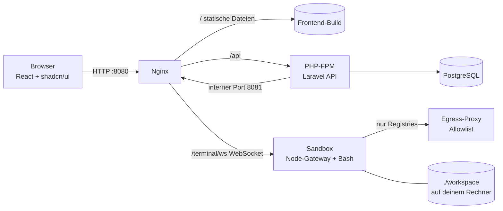

<p align="center">
  
  
</p>

<p align="center"><strong>IT lernen durch echtes Tippen.</strong><br>
Eine interaktive, komplett lokale Lernplattform für IT-Themen – von „Was ist eine Variable?“ bis zum eigenen Projekt auf AWS Fargate.</p>

---

Stacklab ist inspiriert von der klaren Kursstruktur von Laracasts und vom Lernen-durch-Tippen-Ansatz von
gitbybit. Es richtet sich an **komplette Anfänger:innen und Junior-Entwickler:innen**: Jedes Thema wird
vollständig, in einfacher Sprache und mit vielen Beispielen erklärt – und in **jeder** Lektion löst du
selbst Aufgaben.

## Was Stacklab kann

- **Über 50 Kurse in empfohlener Reihenfolge** – Grundlagen & Werkzeuge, Web & APIs, Frontend, Backend
  (Laravel als größter Kurs), Infrastruktur & Betrieb, Capstone-Projekt.
- **Echtes Übungs-Terminal im Browser.** Du tippst echte Befehle (git, npm, bun, composer, artisan …) in
  einem abgesicherten Container. Alles, was du baust, liegt als echtes Projekt in deinem Workspace-Ordner
  auf der Festplatte – pro Kurs ein eigener Unterordner. Stacklab prüft danach den **echten Zustand**
  (Dateien, Git-Historie, package.json, Versionen …).
- **Simulierter Terminal-Modus** für Dinge, die lokal nicht echt gehen (SSH auf fremde Server, DNS, AWS).
- **Code im Browser**: JavaScript, TypeScript und React laufen direkt im Browser mit automatischen Tests;
  PHP läuft im Übungs-Container.
- **Konzept-Aufgaben**: Drag & Drop, Reihenfolgen, Diagramme beschriften, HTTP-Requests zusammenbauen,
  „Was passiert als Nächstes?“-Simulationen.
- **Begriffslexikon**: Jedes Fachwort ist anklickbar. Beim Lesen schaltest du Begriffe frei und baust dein
  persönliches Lexikon auf.
- **Quizze** nach jeder Lektion (Multiple Choice, Lückentext, Zuordnung, „Finde den Fehler“).
- **Begleitete Projekte** und **Prüfungen** mit Schwächenanalyse und Zertifikat für jeden Kurs.
- **Nachschlagewerk**: Volltextsuche über alle Inhalte, Lesezeichen, Notizen, Fortschritt, Streaks, Badges.
- **Mobile-First**, Dark/Light-Mode, dezente Animationen.

## Schnellstart

Du brauchst nur **Docker** (Docker Desktop auf macOS/Windows, Docker Engine + Compose-Plugin auf Linux)
und **Git**. Sonst nichts – kein PHP, kein Node, keine Datenbank.

```bash
git clone https://github.com/SynKeles44/stacklab.git
cd stacklab
docker compose up -d
```

Der erste Start dauert einige Minuten (Images bauen, Abhängigkeiten installieren, Datenbank anlegen,
alle Lerninhalte importieren, Frontend bauen). Danach öffnest du **http://localhost:8080**, legst ein
lokales Konto an und legst los.

Alternativ mit `make`:

```bash
make setup
```

### macOS

1. [Docker Desktop](https://www.docker.com/products/docker-desktop/) installieren und starten.
2. Terminal öffnen und die drei Befehle aus dem Schnellstart ausführen.

### Windows

1. [Docker Desktop](https://www.docker.com/products/docker-desktop/) mit WSL 2-Backend installieren.
2. Am besten in der WSL-Distribution (z. B. Ubuntu) arbeiten: Dort `git clone …` ausführen – Dateizugriffe
   sind dort deutlich schneller als unter `C:\`.
3. `docker compose up -d` ausführen, dann http://localhost:8080 öffnen.

### Linux

1. Docker Engine und das Compose-Plugin installieren (`docker compose version` muss funktionieren).
2. Falls deine Benutzer-ID nicht `1000` ist (prüfen mit `id -u`), lege eine `.env` an und trage die IDs ein,
   damit Dateien im Workspace dir gehören:

   ```bash
   cp .env.example .env
   sed -i "s/^STACKLAB_UID=.*/STACKLAB_UID=$(id -u)/; s/^STACKLAB_GID=.*/STACKLAB_GID=$(id -g)/" .env
   ```

3. `docker compose up -d`, dann http://localhost:8080 öffnen.

## Dein Workspace

Standardmäßig legt Stacklab den Ordner `./workspace` im Projekt an. Darin entsteht pro Kurs ein Unterordner:

```text
workspace/
├── git/          ← alles aus dem Git-Kurs
├── npm/          ← Node.js & Paketmanager
├── laravel/      ← deine Laravel-Projekte
└── …
```

Öffne diese Ordner jederzeit mit deinem eigenen Editor (VS Code, PhpStorm …) – das Gelernte liegt als
echtes Projekt auf deiner Platte. Den Pfad änderst du in der Oberfläche unter **Einstellungen** oder in
der `.env` (`STACKLAB_WORKSPACE=/pfad/zu/deinem/ordner`) und startest danach neu (`docker compose up -d`).
Bequemer geht es mit `make workspace`: Der Befehl öffnet den Ordner-Dialog deines Systems und erledigt beides.

## Architektur



| Dienst | Aufgabe |
|---|---|
| `nginx` | Liefert das Frontend aus, leitet `/api` an PHP-FPM und `/terminal/ws` an die Sandbox weiter |
| `php` | Laravel 13 REST-API: Konten, Kurse, Fortschritt, Prüfungen, Suche; importiert beim Start alle Inhalte |
| `db` | PostgreSQL 18 mit deutscher Volltextsuche |
| `frontend` | Baut das React-Frontend (Bun + Vite) beim Start und beendet sich danach |
| `sandbox` | Übungs-Terminal: Debian mit git, Node/nvm, Bun, npm, PHP, Composer, Pint, PHPStan …; WebSocket-Terminal, Zustandsprüfungen |
| `proxy` | Egress-Proxy: Die Sandbox erreicht nur Paket-Registries (npm, Packagist, GitHub, nodejs.org) |

### Sicherheit des Übungs-Terminals

- Läuft als unprivilegierter Benutzer `learner`, alle Linux-Capabilities entfernt, `no-new-privileges`.
- Ressourcen-Limits (Speicher, CPU, Prozessanzahl) – einstellbar in der `.env`.
- Eingebunden ist **nur** dein Workspace-Ordner, sonst nichts von deinem Rechner.
- Eigenes, internes Docker-Netzwerk ohne Internetzugang; nur der Proxy mit Allowlist führt nach draußen.
- PHP-FPM und die Datenbank sind aus der Sandbox nicht erreichbar.
- Terminal-Sitzungen werden mit kurzlebigen, signierten Tokens geöffnet.

### Tech-Stack

- **Frontend:** React 19, TypeScript, Vite 8, Bun, Tailwind CSS 4, shadcn/ui (einzige Komponentenbibliothek),
  React Router 8 (Data Mode), Zod, Motion, CodeMirror 6, xterm.js
- **Backend:** PHP 8.5, Laravel 13, Sanctum, PostgreSQL 18, Pest, Larastan, Pint
- **Sandbox:** Node.js 24, node-pty, ws

## Inhalte bearbeiten und beitragen

Alle Lerninhalte liegen als Markdown- und YAML-Dateien unter [`content/`](content/). Nach dem Bearbeiten:

```bash
make validate   # Inhalte prüfen
make import     # in die Datenbank übernehmen
```

Details: [CONTRIBUTING.md](CONTRIBUTING.md), [content/README.md](content/README.md) (Format) und
[docs/AUTHORING.md](docs/AUTHORING.md) (Stil und Tiefe).

## Nützliche Befehle

| Befehl | Wirkung |
|---|---|
| `make setup` | Erster Start (baut alles) |
| `make up` / `make down` | Starten / Stoppen |
| `make logs` | Logs aller Dienste verfolgen |
| `make dev` | Frontend mit Hot Reload auf http://localhost:5173 |
| `make test` | Backend-, Frontend- und Sandbox-Tests |
| `make validate` | Lerninhalte prüfen |
| `make import` | Lerninhalte neu importieren |
| `make shell` | Shell im Übungs-Container |
| `make workspace` | Workspace-Ordner per Finder/Explorer-Dialog wählen (schreibt `.env`, startet neu) |
| `make restart` | Neustart nach Änderung des Workspace-Pfads |

## Fehlerbehebung

| Problem | Lösung |
|---|---|
| `http://localhost:8080` lädt nicht | `docker compose ps` – laufen alle Dienste? `docker compose logs php` zeigt, ob Migration/Import noch laufen. |
| Port 8080 ist belegt | In `.env` `STACKLAB_PORT=8090` setzen, `docker compose up -d`. |
| Terminal zeigt „getrennt“ | `docker compose logs sandbox` prüfen; `docker compose restart sandbox`. |
| `npm install` im Terminal schlägt fehl | Nur Paket-Registries sind erreichbar. Ist die Registry in `docker/proxy/allowlist`? |
| Dateien im Workspace gehören `root` (Linux) | `STACKLAB_UID`/`STACKLAB_GID` in `.env` setzen, `docker compose build sandbox && docker compose up -d`. |
| Frontend zeigt alte Version | `docker compose run --rm frontend` baut neu. |
| Nur den Lernfortschritt löschen | In der App unter *Einstellungen → Fortschritt zurücksetzen*. |
| Alles zurücksetzen | `docker compose down -v` löscht Datenbank und Fortschritt (nicht den Workspace). |
| Windows: sehr langsam | Repository in der WSL-Distribution klonen, nicht unter `C:\`. |

## Lizenz

[MIT](LICENSE) © 2026 [SynKeles44](https://github.com/SynKeles44)
