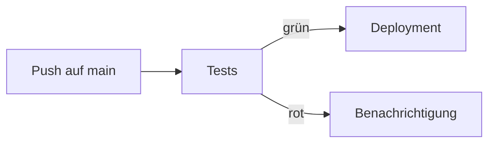

Du hast eine lange Deployment-Anleitung geschrieben. Ganz unten, im fünften Absatz, steht der wichtigste Satz:
„Vorher unbedingt ein Backup machen!“ Natürlich liest ihn niemand. GitHub bietet drei Werkzeuge, damit das
Wichtige auffällt und lange Seiten navigierbar bleiben: **Hinweise**, **Diagramme** und **Anker-Links**.

## GitHub-Alerts: Hinweise, die auffallen

Ein [[github-alert|GitHub-Alert]] ist ein Zitat (`>`), dessen erste Zeile einen Typ in eckigen Klammern trägt.
GitHub zeigt es als farbigen Kasten mit Symbol:

```markdown
> [!WARNING]
> Erstelle vor der Migration ein Backup der Datenbank.
```

Es gibt genau fünf Typen:

| Typ | Wofür |
|---|---|
| `[!NOTE]` | Zusatzinfo, die man auch beim Überfliegen sehen soll |
| `[!TIP]` | Ein Kniff, der Zeit spart |
| `[!IMPORTANT]` | Etwas, das man wissen muss, um ans Ziel zu kommen |
| `[!WARNING]` | Dringend beachten, sonst gibt es Probleme |
| `[!CAUTION]` | Riskante Aktion mit möglichen negativen Folgen |

Ein unbekannter Typ wie `[!DANGER]` funktioniert nicht – dann erscheint nur ein normales Zitat. Andere Plattformen
wie GitLab haben eigene Schreibweisen; GitHub-Alerts sind eine GitHub-Erweiterung.

> [!FEHLER]
> Fünf Warnkästen auf einer Seite. Wenn alles wichtig ist, ist nichts mehr wichtig. Ein bis zwei Alerts pro
> Seite sind ein guter Richtwert.

## Mermaid: Diagramme als Text

Ein Diagramm als Bild hat ein Problem: Ändert sich der Ablauf, muss jemand das Bild neu zeichnen – und das
passiert selten. [[mermaid|Mermaid]] löst das: Du beschreibst das Diagramm als **Text**, und GitHub zeichnet es.

~~~markdown

~~~

So liest du den Text:

- `flowchart LR` – ein Ablaufdiagramm von **l**inks nach **r**echts (`TD` wäre von oben nach unten).
- `A[Push auf main]` – ein Kasten mit der Kennung `A` und einer Beschriftung.
- `-->` – ein Pfeil, `-->|grün|` ein beschrifteter Pfeil.

Weil das Diagramm Text ist, siehst du Änderungen im [[diff|Diff]] eines Pull Requests genau wie Code-Änderungen.

> [!MERKSATZ]
> Ein Diagramm als Mermaid-Text wird mit dem Code gepflegt. Ein Diagramm als Bild veraltet.

## Weitere Mermaid-Diagramme

Mermaid kann mehr als Abläufe. Zwei Typen begegnen dir oft:

| Typ | Schlüsselwort | Gut für |
|---|---|---|
| Ablaufdiagramm | `flowchart` | Prozesse, Entscheidungen, Architektur-Überblick |
| Sequenzdiagramm | `sequenceDiagram` | Wer ruft wen in welcher Reihenfolge auf |

```text title="Ein Sequenzdiagramm in Mermaid"
sequenceDiagram
  Browser->>API: POST /login
  API->>Datenbank: Nutzer suchen
  Datenbank-->>API: Treffer
  API-->>Browser: 200 OK mit Token
```

Weitere Typen (Zustandsdiagramme, Gantt-Diagramme, ER-Diagramme) findest du in der
[Mermaid-Dokumentation](https://mermaid.js.org/intro/). Halte Diagramme klein: lieber zwei übersichtliche als
ein Riesendiagramm.

## Anker-Links und Inhaltsverzeichnis

GitHub gibt jeder Überschrift automatisch einen [[anker-link|Anker]]. Mit `#anker` springst du direkt dorthin –
innerhalb der Seite oder von einer anderen Datei aus:

```markdown
- [Installation](#installation)
- [Häufige Fehler](#häufige-fehler)
- [Konfiguration der Datenbank](docs/konfiguration.md#datenbank)
```

So entsteht der Anker aus der Überschrift:

1. Alles kleinschreiben.
2. Satzzeichen wie `!`, `?`, `&`, `.` entfernen. Buchstaben (auch Umlaute), Ziffern, `-` und `_` bleiben.
3. Jedes Leerzeichen durch `-` ersetzen.

| Überschrift | Anker |
|---|---|
| `## Installation` | `#installation` |
| `## Schnell starten!` | `#schnell-starten` |
| `## Fragen & Antworten` | `#fragen--antworten` |

> [!PRAXIS]
> GitHub zeigt über jeder Markdown-Datei ein automatisches Inhaltsverzeichnis an (Symbol oben rechts). Ein
> eigenes am Anfang lohnt sich trotzdem bei langen Seiten – es funktioniert auch außerhalb von GitHub.

## Zusammenfassung

- **GitHub-Alerts**: `> [!NOTE]`, `[!TIP]`, `[!IMPORTANT]`, `[!WARNING]`, `[!CAUTION]` – sparsam einsetzen.
- **Mermaid**: Diagramme als Text in einem Codeblock mit der Sprache `mermaid`.
- `flowchart LR` mit `-->` zeichnet Abläufe; `sequenceDiagram` zeigt Aufrufe.
- Jede Überschrift hat einen **Anker**: klein, ohne Satzzeichen, Leerzeichen werden zu `-`.
- Ein Inhaltsverzeichnis aus Anker-Links macht lange Seiten navigierbar.
