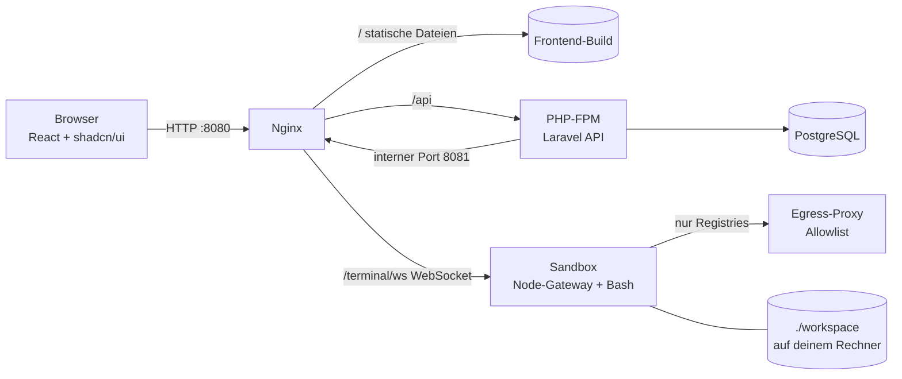

# Architektur

| Dienst | Aufgabe |
|---|---|
| `nginx` | Liefert das Frontend aus, leitet `/api` an PHP-FPM und `/terminal/ws` an die Sandbox weiter |
| `php` | Laravel 13 REST-API: Konten, Kurse, Fortschritt, Prüfungen, Suche; importiert beim Start alle Inhalte |
| `db` | PostgreSQL 18 mit deutscher Volltextsuche |
| `frontend` | Baut das React-Frontend (Bun + Vite) beim Start und beendet sich danach |
| `sandbox` | Übungs-Terminal: Debian mit git, Node/nvm, Bun, npm, PHP, Composer, Pint, PHPStan …; WebSocket-Terminal, Zustandsprüfungen |
| `proxy` | Egress-Proxy: Die Sandbox erreicht nur Paket-Registries (npm, Packagist, GitHub, nodejs.org) |

## Sicherheit des Übungs-Terminals

- Läuft als unprivilegierter Benutzer `learner`, alle Linux-Capabilities entfernt, `no-new-privileges`.
- Ressourcen-Limits (Speicher, CPU, Prozessanzahl) – einstellbar in der `.env`.
- Eingebunden ist **nur** dein Workspace-Ordner, sonst nichts von deinem Rechner.
- Eigenes, internes Docker-Netzwerk ohne Internetzugang; nur der Proxy mit Allowlist führt nach draußen.
- PHP-FPM und die Datenbank sind aus der Sandbox nicht erreichbar.
- Terminal-Sitzungen werden mit kurzlebigen, signierten Tokens geöffnet.

## Tech-Stack

- **Frontend:** React 19, TypeScript, Vite 8, Bun, Tailwind CSS 4, shadcn/ui (einzige Komponentenbibliothek),
  React Router 8 (Data Mode), Zod, Motion, CodeMirror 6, xterm.js
- **Backend:** PHP 8.5, Laravel 13, Sanctum, PostgreSQL 18, Pest, Larastan, Pint
- **Sandbox:** Node.js 24, node-pty, ws
